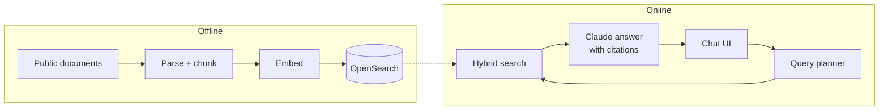

# Medical RAG — Beyond Doc

A reproducible retrieval-augmented generation (RAG) system that answers questions about medicines from
**approved public documents** only: drug labels (DailyMed), FDA approval letters (Drugs@FDA), open-access research
(PubMed Central) and NIH LiverTox monographs. Every answer cites the passages it used, or says plainly that the
documents do not cover the question.

> **Informational demo only.** Not medical advice, not a diagnosis or treatment system. No patient data is used.

Contents: [Setup](#setup) · [Architecture](#architecture-overview) · [More documentation](#more-documentation)

---

## Setup

Full guide (local Linux, a single Linux server behind nginx, Google Cloud): **[docs/INSTALL.md](docs/INSTALL.md)**.

Requirements: Python 3.11, Docker with Compose, Node.js 22 (UI build only), an Anthropic API key.

```bash
git clone <repository-url> RagMedical && cd RagMedical
python3.11 -m venv .venv
.venv/bin/pip install --index-url https://download.pytorch.org/whl/cpu \
    --extra-index-url https://pypi.org/simple -r requirements-dev.txt -e .
cp .env.example .env && chmod 600 .env     # add ANTHROPIC_API_KEY and MEDRAG_CLICKHOUSE_PASSWORD
docker compose up -d                        # OpenSearch, Redis, ClickHouse on 127.0.0.1

# corpus → chunks → embeddings → index (the corpus is not stored in Git)
.venv/bin/python -I scripts/phase1/openfda_bulk_download.py
.venv/bin/python -I scripts/phase1/select_dailymed_candidates.py
.venv/bin/python -I scripts/phase1/plan_batch_01.py
.venv/bin/python -I scripts/phase1/download_batch.py --batch batch_01
.venv/bin/python -X utf8 scripts/phase2/chunk_sample.py --set batch01
.venv/bin/python -X utf8 scripts/phase3/embed_chunks.py --experiment E3_fill
.venv/bin/python -X utf8 scripts/phase3/build_index.py --experiment E3_fill
.venv/bin/python -X utf8 scripts/phase5/build_medicine_aliases.py

(cd frontend && npm ci && npm run build)
.venv/bin/uvicorn medical_rag.api.main:app --host 127.0.0.1 --port 8000
# http://127.0.0.1:8000/ chat · /explorer retrieval explorer · /docs API
```

Recommended settings in `.env`: `MEDRAG_RETRIEVAL_PLAN=v12_t3` (medicine/source/section-aware retrieval) and
`MEDRAG_ANSWER_PROMPT=v4.1` (the default). Checks: `ruff check . && ruff format --check . && pytest` and
`pytest -m integration` (needs the Docker services). On Windows use `.venv/Scripts/`.

---

## Architecture overview



| Layer | Module | Notes |
|---|---|---|
| Ingestion | `src/medical_rag/ingestion/` | Parsers for SPL XML, PMC JATS, LiverTox NXML, FDA PDFs; text normalisation; provenance |
| Chunking | `src/medical_rag/chunking/` | Section-bounded recursive splitting, tables kept as tables, deterministic chunk ids |
| Embedding | `src/medical_rag/embedding/` | `Embedder` interface; pinned, checksum-verified model |
| Query understanding | `src/medical_rag/query/` | Corpus-built medicine resolver; intent and named-source detection (rules, no LLM) |
| Search | `src/medical_rag/search/` | OpenSearch client, index build with alias swap, hybrid retrieval, planner, selection |
| Generation | `src/medical_rag/generation/` | Prompt versions v1–v4.1, JSON-schema output, citation validation, abstention |
| Chat | `src/medical_rag/chat/` | Sessions (ClickHouse), short-term memory and rate limits (Redis), streamed turn pipeline |
| API / UI | `src/medical_rag/api/`, `frontend/` | `/health`, `/search`, `/ask`, `/api/sessions…` (SSE); React 19 + Vite chat UI |
| Evaluation | `src/medical_rag/evaluation/`, `scripts/phase3–5/` | Retrieval metrics, Ragas with a separate judge model, latency benchmarks |
| Observability | `src/medical_rag/observability/` | JSON logs without medical text; Langfuse traces (off by default) |

Identifiers are deterministic: chunk id = SHA-256 of document, version, section and content span; the index name
encodes the chunking config and the embedding model, so a different chunking or model can never mix into an index.
More detail: [docs/architecture.md](docs/architecture.md).

---

## More documentation

Design decisions, evaluation results, productionizing and the rest of the write-up:
**[docs/SOLUTION_OVERVIEW.md](docs/SOLUTION_OVERVIEW.md)**. Full installation guide: [docs/INSTALL.md](docs/INSTALL.md).

## Source credits

U.S. National Library of Medicine (DailyMed, PubMed Central, NCBI Bookshelf), U.S. Food and Drug Administration
(openFDA, Drugs@FDA), NIDDK (LiverTox), and the authors and publishers of each CC-licensed article. Per-document
attribution is kept in the manifests.
