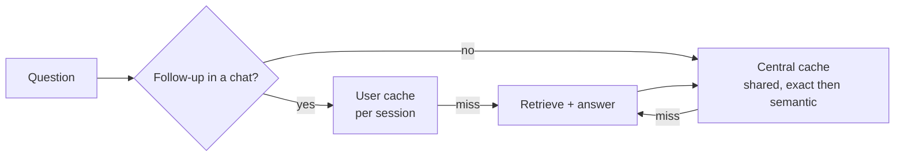

# Medical RAG — solution overview

Companion to the [README](../README.md) (setup and architecture). Informational demo over public documents; not medical advice.

| | |
|---|---|
| Corpus | 100 documents → 5,815 chunks (70 DailyMed labels, 15 PMC articles, 10 FDA letters, 5 LiverTox monographs) |
| Stack | Python 3.11 · FastAPI · OpenSearch 3.8.0 (BM25 + HNSW) · bge-base-en-v1.5 · Claude Sonnet 5.5 · React chat UI · Redis · ClickHouse · Langfuse (optional) |
| Retrieval quality (holdout, 68 answerable questions) | Evidence recall@8 **0.949** (hybrid baseline 0.904), wrong-medicine passages 0.19 per question (baseline 0.87) |
| Answer quality (Ragas, dev 67 answerable) | Faithfulness 0.948 · answer relevancy 0.900 · gold passage cited 0.925 · 0 false refusals |
| Tests | 373 unit + 9 integration (CI on every push) |

Contents: [Productionizing](#c-productionizing-and-deploying-on-a-hyper-scaler) · [RAG/LLM approach](#d-ragllm-approach-and-decisions) · [Key decisions](#e-key-technical-decisions-and-why) · [Caching](#f-caching-strategy-future-work) · [Further reading](#further-reading)

---

## c. Productionizing and deploying on a hyper-scaler

Today the demo runs on one Linux server (one OpenSearch node, two API workers, password protected). That is enough
for a demo, not for real traffic. To make it production-grade:

**1. Application changes (cloud-independent)**
- Stream answer text to the user (first words in ~1 s instead of the full answer after ~5 s).
- Async endpoints and clients; embedding as its own service (batched, ONNX or a small GPU); an **LLM gateway**
  with a global concurrency cap, queue, retries and a clear "busy, try again" (the 503 path exists).
- Containers (`Dockerfile`s for API and embedder), Infrastructure as Code (Terraform), CI/CD with staged rollouts.
- Real authentication (SSO/OIDC) instead of a shared password; per-user quotas; layered caching for repeated questions (see [f. Caching strategy](#f-caching-strategy-future-work)).

**2. Data and quality operations**
- Scheduled ingestion: DailyMed labels change weekly; re-chunk, re-embed and switch the index alias with no downtime
  (the alias-swap build already works this way). Keep old versions for audit.
- Licence approval for each source before production (the source register is still marked *proposed*), medical
  review of answers, red-teaming for unsafe prompts, regression evaluation on every prompt or model change.

**3. Scale and reliability** (sized in [SCALING_GCP_GKE.md](SCALING_GCP_GKE.md): ~10,000 users,
~20 questions/s at peak, ~120 answers in flight; proposed targets: first text P95 < 1.5 s, full answer P95 < 8 s,
retrieval P95 < 300 ms): stateless API pods with autoscaling, 3-node search cluster with replicas, managed Redis,
replicated chat store, edge rate limiting and WAF, tracing and alerts on P50/P95 per stage and cost per answer,
backups and a tested restore, load tests before launch.

**4. Mapping to cloud providers** (concept; only the single-VM setup is built)

| Need | GCP | AWS | Azure | Cloudflare |
|---|---|---|---|---|
| Containers + autoscaling | GKE / Cloud Run | EKS / ECS Fargate | AKS / Container Apps | Workers (edge only; backend runs elsewhere) |
| Search (BM25 + vectors) | OpenSearch on GKE (operator) | Amazon OpenSearch Service | OpenSearch on AKS, or Azure AI Search | Vectorize covers vectors only, not BM25 |
| Claude access | Claude on Vertex AI or Anthropic API | Claude on Amazon Bedrock or Anthropic API | Anthropic API (or Claude in Microsoft Foundry where available) | AI Gateway in front of the Anthropic API (caching, rate limits, logs) |
| Embedding service | GKE GPU pool (L4) | EKS GPU nodes / SageMaker endpoint | AKS GPU nodes / Azure ML endpoint | Workers AI (different models) |
| Memory / rate limits | Memorystore for Redis | ElastiCache for Redis | Azure Cache for Redis | Workers KV / Durable Objects |
| Chat history | ClickHouse on GKE or ClickHouse Cloud | ClickHouse Cloud / self-managed | ClickHouse Cloud / self-managed | D1 (small scale) |
| Secrets | Secret Manager | Secrets Manager | Key Vault | Workers Secrets |
| Edge security | Cloud Armor + HTTPS LB + IAP | WAF + ALB + Cognito | Front Door + WAF + Entra ID | WAF, rate limiting, Access |
| Corpus / embeddings storage | Cloud Storage | S3 | Blob Storage | R2 |
| Observability | Cloud Logging, Managed Prometheus, Langfuse | CloudWatch, Managed Prometheus, Langfuse | Azure Monitor, Langfuse | Logpush, Langfuse |

Recommended path: GCP or AWS, where Claude is available as a managed service in the same cloud (Vertex AI or
Bedrock) and OpenSearch can run managed or via an operator. Cloudflare fits best as the edge layer (WAF, rate
limits, AI Gateway) in front of either.

---

## d. RAG/LLM approach and decisions

Every choice was proposed, approved, implemented and measured before the next step; open choices stay open.
The full record is [DECISION_LOG.md](DECISION_LOG.md).

| Area | Considered | Chosen (status) | Why |
|---|---|---|---|
| **LLM (answers)** | Claude Opus 5.5, Claude Sonnet 5.5 | **Claude Sonnet 5.5**, effort medium (demo default) | Same grounded answer in 4.0 s vs 8.1 s on the first live check; JSON-schema output; server-side refusal fallback |
| **Evaluation judge** | Claude Opus 5.5, Kimi K3 | **Kimi K3** on Fireworks, temperature 0 | A different model family, so the generator never grades itself |
| **Embedding model** | bge-base-en-v1.5, MedCPT | **bge-base-en-v1.5** (selected; MedCPT not benchmarked yet) | MIT licence, runs on CPU, 768-d; its vocabulary equals the chunk-counting tokenizer, so the 510-token limit is exact |
| **Vector database** | OpenSearch, dedicated vector DBs | **OpenSearch 3.8.0**: one index with BM25 text and HNSW vectors | Keyword and vector search in one engine, filters, alias swap for re-indexing; HNSW is a demo default (flat/IVF still to compare at scale) |
| **Sparse retrieval** | BM25, learned sparse (e.g. bge-m3) | **BM25** (demo default) | Catches exact drug names, doses and section words that dense search blurs |
| **Fusion** | Reciprocal rank fusion, score normalisation | **RRF, k = 60**, client-side | No score calibration between BM25 and cosine; each component's rank stays visible |
| **Reranker** | MiniLM-L6 cross-encoder (tested), MedCPT cross-encoder | **None** | +3.6 s per question on CPU, wrong-drug reorderings, no recall gain (see e.) |
| **Orchestration framework** | LangChain, LlamaIndex, plain Python | **Plain Python with typed interfaces** | Each stage (parse, chunk, embed, retrieve, fuse, select, generate, evaluate, trace) is small, testable and swappable; no hidden prompt or retrieval behaviour. LangChain appears only as a Ragas dependency |
| **Query understanding** | LLM entity extraction, rules | **Deterministic rules** built from the corpus | Medicine names resolved from the corpus alias table (brand → generic, salts); no invented brand–generic links; no LLM latency |

**Prompt and context management**
- Context = the top **8** passages (~3.5–6 k input tokens), each labelled `[S1]…[S8]` with its document title and
  section path; passages are marked as data, not instructions.
- Chat memory: the last 6 turns in Redis (rehydrated from ClickHouse). A follow-up is rewritten into a standalone
  query by Claude before retrieval; the history helps understanding but is never evidence.
- Output is constrained by a JSON schema (`coverage`, `abstain`, `answer`, `cited_sources`).
- Prompt versions are kept side by side and selectable (`MEDRAG_ANSWER_PROMPT`): v1 original → v2 polite and
  numbered → v3 tuned style → v4 related answers → **v4.1** related answers with a dose safeguard
  ([ANSWER_PROMPT_REPORT.md](ANSWER_PROMPT_REPORT.md)).

**Guardrails**
- Answers use only the retrieved passages; every factual sentence must cite a passage id. Citation ids are checked
  against what was sent; an answer with no valid citation becomes an abstention.
- Coverage decision: *full* (answer), *related* (say politely what the documents do not cover, then cited facts
  about the same medicine or condition, never a recommendation), *none* (abstain).
- Dose safeguard: no doses for a use, condition or group the documents do not cover.
- Prompt-injection resistance (passages are data), disclaimer on every response, consult-a-professional sentence on
  safety, dosing and personal questions.
- Operational: per-user rate limit (20 questions/min), password-protected demo, model refusals and API outages map
  to clear responses (503).

**Quality**
- A reviewed, frozen test set of 150 questions with evidence passages (single- and multi-document, interactions,
  pharmacology, LiverTox, PMC, FDA, unanswerable), split 75 dev / 75 holdout. Decisions use dev; holdout runs once.
- Retrieval scored without an LLM (evidence recall@8, AP@8, MRR, nDCG, wrong-medicine passages, latency); answers
  scored with Ragas (faithfulness, answer relevancy, context precision/recall, claim recall, factual precision) plus
  citation and abstention checks.

**Observability**
- JSON logs with per-stage timings and **no medical text** by default.
- Langfuse traces per request (understand → retrieve → compose: model, tokens, chunk ids, plan, coverage), metadata
  only unless `MEDRAG_TRACE_CONTENT=true`, credential masking, hashed user ids, Cloud or self-hosted by setting.

---

## e. Key technical decisions and why

Each step followed the same loop: propose → approve → implement → test → measure → record. The numbers below come
from the reports in `docs/` and `data/processed/` (gitignored).

1. **Corpus first, governed.** 100 documents chosen by explicit rules (reference-brand label first, one drug class
   slot before popularity, duplicates grouped by ingredient + route + form) with URL, version, licence basis and
   SHA-256 for every file. Originals are never modified; no patient data. *Why:* citations are only as trustworthy
   as their provenance.
2. **A parser per source, structure-aware chunks.** Drug labels, articles, monographs and letters have different
   structures; chunks never cross a section, long sections split at the largest natural boundary (block → table
   rows → cells → sentence → clause), tables stay tables. Four overlap settings (0/32/64/96 tokens) all kept 100% of
   the text; **64** is the demo default. *Open:* overlap has not yet been compared on retrieval quality.
3. **Token limit counted with the model's own vocabulary.** bert-base-uncased counts the 510-token ceiling and has
   exactly bge-base's vocabulary, so 0 of 5,815 chunks are counted differently from what the model sees.
4. **Hybrid search over dense-only.** On the first test set dense ranked best (hit@5 0.923 vs hybrid 0.885), but
   those questions were written from the gold passage, which favours paraphrase. Hybrid kept the highest recall@10
   (0.954) and protects exact names and numbers, so hybrid became the base.
5. **A frozen evaluation set before tuning.** The first 145 drafted questions had mislabelled items; v2.0 was
   reviewed question by question, frozen and split dev/holdout, so improvements could not be tuned on the test.
6. **No reranker.** MiniLM-L6 raised AP@8 0.597 → 0.625 but added 3.6 s P50 per question on CPU (about 10× the
   0.5 s budget), moved another drug's label to rank 1 on an interaction question, and could not add recall
   (it only reorders). The misses were coverage problems, so the fix had to be in retrieval.
7. **Document-aware retrieval (Retrieval v1.2, preset T3).** Four deterministic rules: medicine resolver,
   medicine boost with a medicine-filtered vector search, per-source coverage when a question names two sources,
   and section awareness (reference lists and patient-leaflet tables demoted; the section matching the question
   boosted). Eight variants compared on dev, the best checked once on holdout:
   evidence recall@8 0.873 → **0.925** (dev) and 0.904 → **0.949** (holdout), wrong-medicine passages
   1.22 → 0.15, no question lost recall, +20 ms retrieval P50.
8. **Answer behaviour driven by real user questions.** Users asked for polite answers that say when there is no
   simple yes or no and give steps. A live finding ("what is the best solution for renal impairment" was refused
   while "renal impairment" was answered) traced to the answer step, not retrieval, and led to the *related*
   coverage mode; a dose safeguard was added after v4 listed doses for other uses. v4.1 kept 0 false refusals and
   raised faithfulness 0.927 → 0.948 against v1.
9. **Plain Python instead of an orchestration framework**, typed settings from environment variables, and every
   experimental feature behind a setting (`MEDRAG_RETRIEVAL_PLAN`, `MEDRAG_ANSWER_PROMPT`, `MEDRAG_TRACING`), so
   the baseline stays reproducible and each change can be switched off.
10. **Privacy by default.** No medical text in logs or traces unless explicitly enabled for synthetic inputs;
    hashed user ids; keys only in untracked env files; the public repository carries no server names or keys.
11. **Simple, reversible deployment.** One server, own containers on local-only ports, systemd, an nginx sub-path
    with a password, backups before each update, and identical retrieval results on laptop and server
    (byte-identical top-8 results for the same questions).

---

## f. Caching strategy (future work)

Not built yet; this is the planned design. Today the only caches are the chat memory in Redis (last 6 turns per
session) and the embedding model held in memory. A repeated question therefore pays the full cost again: about
190 ms for retrieval (≈145 ms of it embedding the query) and 3–5 s plus input tokens for Claude.

Two families of cache, kept strictly apart:

**Central (shared) cache** — for standalone questions that do not depend on who asks or on chat history.

| Layer | Key | Saves | Invalidation |
|---|---|---|---|
| Query embedding | hash(normalised question, embedding model id) | ~145 ms per hit | model id in the key; long TTL |
| Retrieval result | hash(normalised question, retrieval plan, index name) | ~190 ms per hit (embedding + search), OpenSearch load | the index name changes on every re-index (alias swap), so old entries simply stop matching |
| Exact answer | hash(normalised question, top-8 chunk ids, prompt version, model) | 3–5 s and all LLM tokens | any change of passages, prompt or model is a new key; TTL (e.g. 7 days); abstentions only 1 day |
| Semantic answer | question embedding, nearest cached question | same as exact | reuse only when similarity is very high (e.g. ≥ 0.97) **and** the new question retrieves the same top-8 chunk ids |
| Prompt prefix | Anthropic prompt caching of the fixed system prompt | input-token cost and some latency on every call | handled by the provider |

**User-based cache** — scoped to one user or session, keyed by the hashed user id, never shared.

| Layer | Purpose | Lifetime |
|---|---|---|
| Session memory (exists) | last 6 turns for follow-up questions | 24 h in Redis, rebuilt from ClickHouse |
| Rewritten follow-up query | skip the 1.5–3 s rewrite when the same follow-up is asked again in the session | session lifetime |
| Recent answers | instant re-open, copy or "regenerate" of the user's own answers | session lifetime; deleted with the session |
| Per-user quotas and rate limits (exist) | protect cost under load | rolling windows |

**Rules for a medical demo**
- Cache only what is grounded: an answer is reused only together with its cited passages, and the key includes the
  passage ids, so a reused answer always matches the evidence shown.
- Never share user-specific content: follow-up questions and anything tied to chat history stay in the user cache.
- The semantic cache is conservative: a near-duplicate question must also retrieve exactly the same passages,
  otherwise it is a miss. Dose and interaction questions can be excluded entirely if review shows any risk.
- Corpus, prompt or model updates invalidate by construction (versions are part of every key); a manual purge
  remains available.
- Cached text follows the same privacy rule as logs and traces: stored in Redis only, with a TTL, and never written
  to logs.

**Technology**
- Central cache: Redis (Memorystore / ElastiCache / Azure Cache) for exact keys; Redis vector search or a small
  OpenSearch k-NN index for the semantic layer.
- Edge: Cloudflare AI Gateway (or the cloud's API gateway) can add exact-prompt caching and rate limiting in front
  of the Claude API.
- Measurement: hit rate per layer, latency saved, tokens saved and stale-hit checks as Langfuse trace metadata
  (`cache: hit/miss/layer`), plus a regression run of the evaluation set with the cache on, to prove answers do
  not change.

**Rollout order:** query-embedding cache → retrieval cache → exact answer cache → prompt caching → semantic
cache (last, after the evaluation shows no quality loss).

---

## Further reading

| Document | Contents |
|---|---|
| [INSTALL.md](INSTALL.md) | Local, single-server and Google Cloud installation; Langfuse setup |
| [decision.md](decision.md) | The author's decisions and process, in the author's words |
| [DECISION_LOG.md](DECISION_LOG.md) | Every decision with status and evidence |
| [RETRIEVAL_V12_REPORT.md](RETRIEVAL_V12_REPORT.md) | Document-aware retrieval: arms, dev and holdout results, latency |
| [PHASE4_RERANKING_REPORT.md](PHASE4_RERANKING_REPORT.md) | Reranker experiment and why it was rejected |
| [ANSWER_PROMPT_REPORT.md](ANSWER_PROMPT_REPORT.md) | Prompt versions v1–v4.1 with Ragas results |
| [SCALING_GCP_GKE.md](SCALING_GCP_GKE.md) | Scaling concept for ~10,000 users |
| [data/SOURCE_REGISTER.md](data/SOURCE_REGISTER.md) | Sources, licences, attribution, corpus rules |
| [demo/demo_brief.html](demo/demo_brief.html) | Demo walkthrough page |

## Configuration and privacy

All settings are environment variables with the `MEDRAG_` prefix (see `.env.example`), validated at startup.
Query and answer text is **not logged** unless `MEDRAG_LOG_QUERY_TEXT=true`, and Langfuse traces carry metadata
only unless `MEDRAG_TRACE_CONTENT=true`; both are for synthetic demo inputs only. `.env`, `data/` and the virtual
environment are git-ignored.
